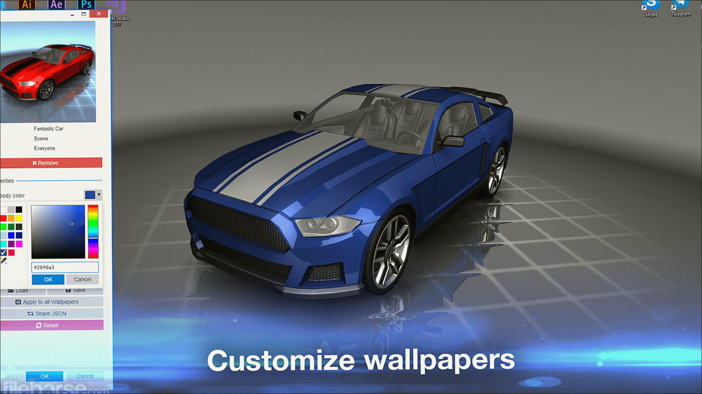
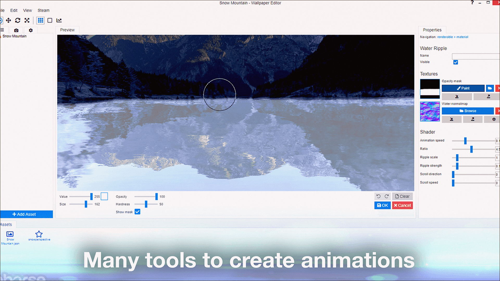

# Windows notes: Wallpaper Engine

**Wallpaper Engine** · 2.8 · 237 MB · Utilities catalog

[Open card](https://moggydayprogram.com/programs/wallpaper-engine) · [English](https://moggydayprogram.com/en/programs/wallpaper-engine) · [GitHub Pages](https://logomaidspin.github.io/wallpaper-engine-windows/?lang=en)

  
  
  

Обои с Workshop. Русский. Жрёт GPU в простое.

Wallpaper Engine on Windows 10/11 x64. 237 MB. Requirements, screenshots, MoggyDay Launcher.

Get it from the catalog card, not from this repository.

| Field | Value |
| --- | --- |
| Build | 2.8.42 |
| OS | Windows 10/11 x64 |
| Pages | https://logomaidspin.github.io/wallpaper-engine-windows/ |

- [GPU-Z](https://moggydayprogram.com/programs/gpu-z)
- [Process Lasso](https://moggydayprogram.com/programs/process-lasso)
